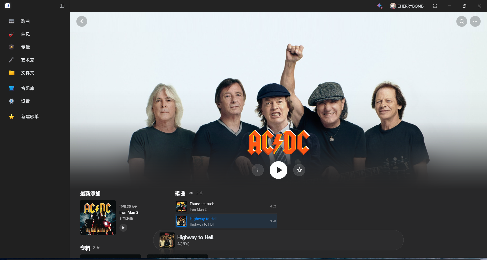
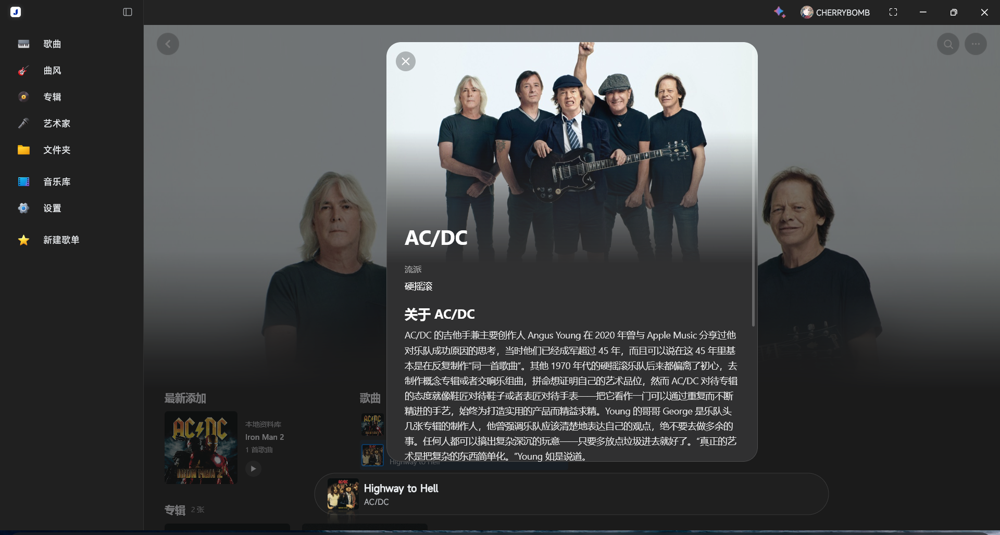
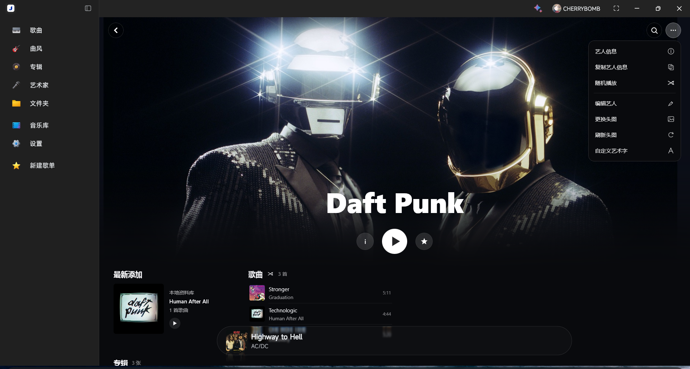
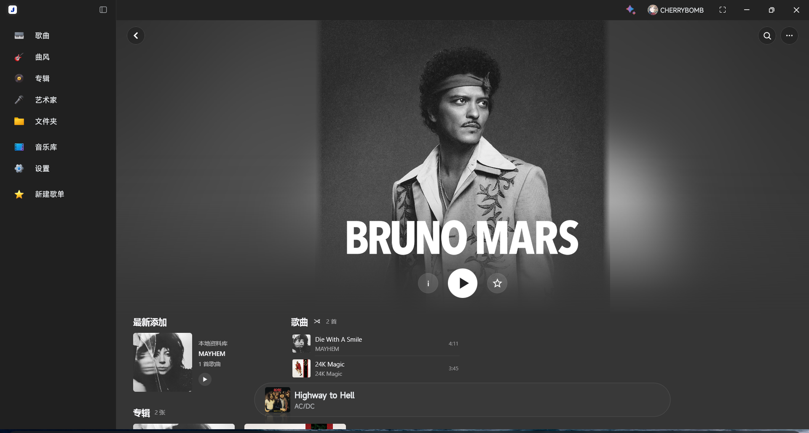
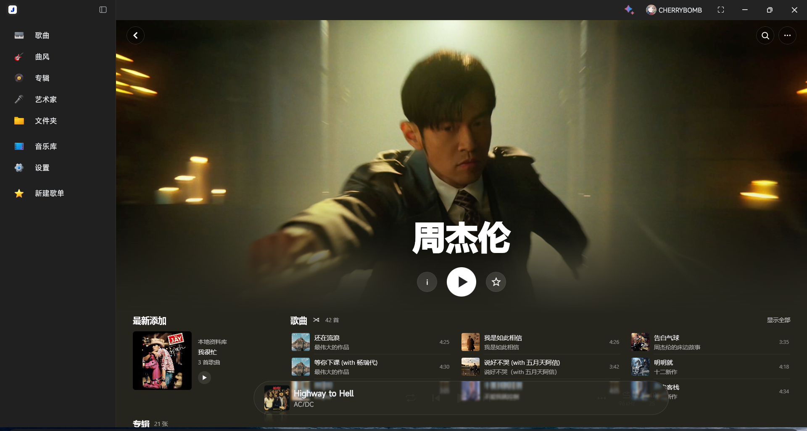
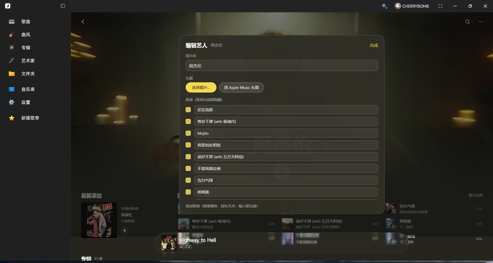
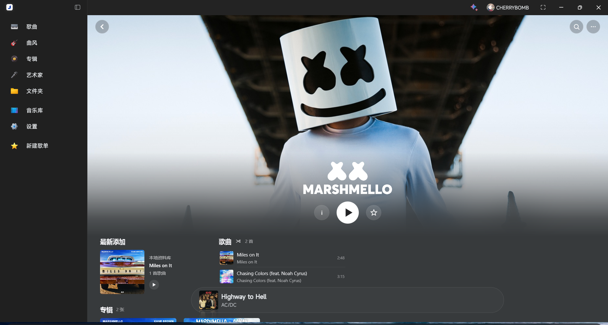
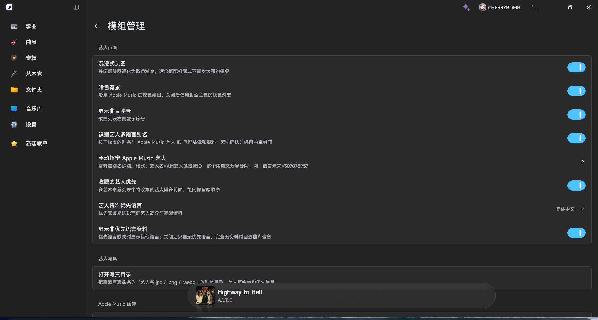

# Salt Artist

[](https://github.com/asukua/salt-artist/actions/workflows/build.yml)

为 **Salt Player for Windows** 打造的第三方沉浸式艺人页插件。以 Apple Music 艺人页为灵感，连接你的本地曲库、播放队列与导航。

[下载最新版本](https://github.com/asukua/salt-artist/releases/latest) · [兼容说明](docs/host-compatibility.md) · [设计与技术说明](docs/artist-design.md)



<details>
<summary>更多预览</summary>















</details>

## 功能

- **主要是仿am美化。
- **沉浸式头图**：动态取色、宽渐隐、方图羽化、滚动模糊与折叠顶栏。
- **本地音乐联动**：单曲、整张专辑和随机播放，当前曲目高亮，保留宿主迷你播放器。
- **紧凑曲库浏览**：最新添加、歌曲搜索与响应式专辑网格。
- **Apple Music 资料**：头图、头像、艺术字与艺人简介；支持中文、英语、日语及其他语言回退，缺少资料时显示曲库统计。
- **艺人列表增强**：Apple Music 小圆头像与收藏艺人稳定置顶。
- **本地自定义**：显示名、头图、透明艺术字、歌曲显隐与改名、从曲库添加歌曲、专辑改名。

自定义与收藏保存在插件配置中，不修改音乐文件。Apple Music 别名识别只影响素材匹配，不合并艺人条目或歌曲。

## 兼容与安装

当前登记兼容 **SPW 1.19.0 / 1.19.1**；艺人列表增强按 1.19.1 适配。其他宿主版本保留原生页面，升级宿主后可能需要更新插件。

1. 从 [Releases](https://github.com/asukua/salt-artist/releases/latest) 下载 `.spmod`；需要校验时使用同一 Release 附带的 `.sha256` 文件。
2. 在 SPW「模组管理」中导入并启用，授予相关权限。
3. 打开艺人详情页。停用或卸载插件后恢复原生页面。

## 配置

在「模组管理 → Salt Artist → 配置」中调整资料语言、其他语言回退、收藏优先和艺人别名识别。更多菜单可编辑艺人、换头图或导入透明 PNG/WebP 艺术字；写真目录和缓存清理位于配置页。

目前艺人名要精准匹配才能显示，加了几个部分艺人的别名，如果无法匹配可以自行指定。

需要指定目标时，在 `artist_identity_overrides` 中填写「曲库艺人名=Apple Music 艺人链接或纯 ID」，多项用英文分号或换行分隔：

已经获取的信息会缓存，30天后自动清除，也可以在配置里手动清除。

```text
初音未来=307078957;周杰伦=300117743
```

手动绑定需要开启 `recognize_artist_aliases`；关闭后手动和自动别名绑定都会忽略。修改绑定或切换开关会隔离旧匹配缓存，无需手动清除。详细规则见 [身份与别名设计](docs/artist-design.md#apple-music-身份与别名)。

## 开发

使用 **JDK 25**，将 `JAVA_HOME` 指向 JDK 安装目录，然后运行：

```sh
./gradlew test plugin
```

Windows PowerShell 使用 `.\gradlew.bat test plugin`。产物位于 `build/libs/plugin-dev.saltartist-0.1.5.spmod`。首次构建需要联网获取依赖。

插件使用 Kotlin 与 Compose Multiplatform，运行时由宿主提供。接入、权限与反射约束见 [兼容记录](docs/host-compatibility.md)，身份匹配、缓存与列表 Hook 的取舍见 [设计文档](docs/artist-design.md)。

## 项目说明与致谢

Salt Artist 是第三方社区项目，不是 Salt Player 或 Apple 的官方产品。感谢 Salt Player for Windows 和 [Moriafly/spw-workshop-api](https://github.com/Moriafly/spw-workshop-api) 提供的官方插件 API。

源码采用 [Apache License 2.0](LICENSE)。预览中的第三方图片、音乐封面和商标不随源码许可证授权，详见 [第三方声明](THIRD_PARTY_NOTICES.md)。
