# Salt Artist

给 **Salt Player for Windows** 换一套 Apple Music 风格的艺人页。

[下载最新版本](https://github.com/asukua/salt-artist/releases/latest) · [兼容说明](docs/host-compatibility.md) · [设计与技术说明](docs/artist-design.md)

## 功能

- **沉浸式头图**：取色渐隐、滚动虚化；动态头图支持 24／30 帧和 1080p／2K／4K，视频缓存在本地。
- **本地曲库联动**：最新添加、歌曲搜索、专辑网格，支持单曲、整张专辑和随机播放，当前曲目高亮。
- **艺人资料与匹配**：可选资料语言、识别内置别名；匹配不对时在艺人页手动选择，支持多地区重试和自定义顺序。
- **艺人列表**：AM 圆形头像、四种视图、三档大小、搜索排序、收藏优先；选择自动保存，返回时记住浏览位置。
- **自定义内容**：头图、透明艺术字、显示名，歌曲隐藏与改名、从曲库添加歌曲、专辑改名。
- **移除与恢复**：支持多选移除艺人、单独或批量恢复，只隐藏列表条目，保留歌曲和文件。

## 预览

[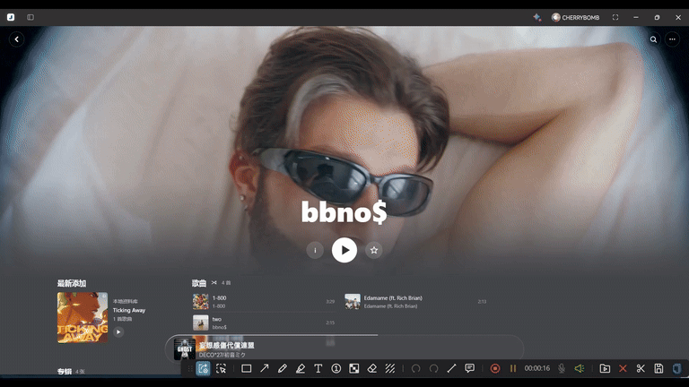](https://github.com/asukua/salt-artist/releases/download/v0.2.4/preview-bbnos.mp4)

[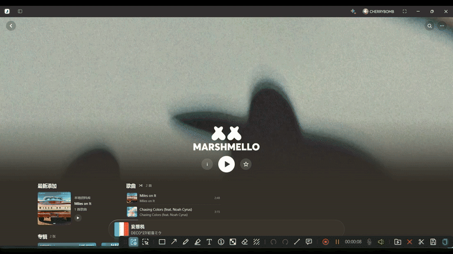](https://github.com/asukua/salt-artist/releases/download/v0.2.4/preview-marshmello.mp4)

[完整视频：bbno$](https://github.com/asukua/salt-artist/releases/download/v0.2.4/preview-bbnos.mp4) · [Marshmello](https://github.com/asukua/salt-artist/releases/download/v0.2.4/preview-marshmello.mp4)

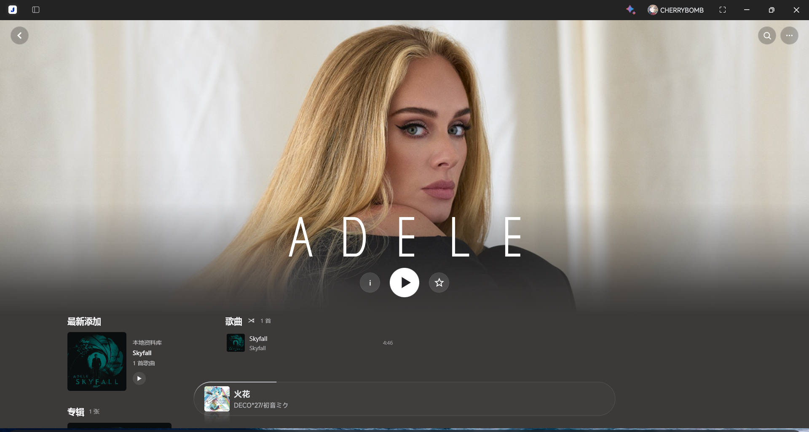

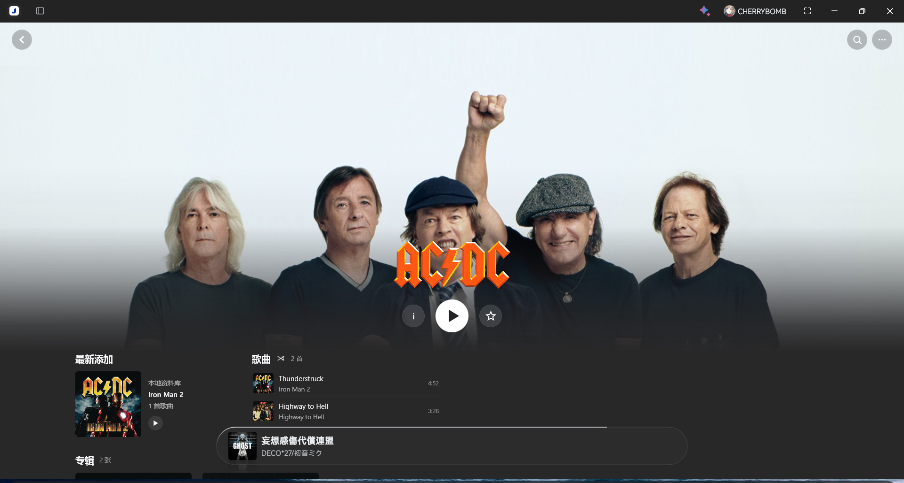

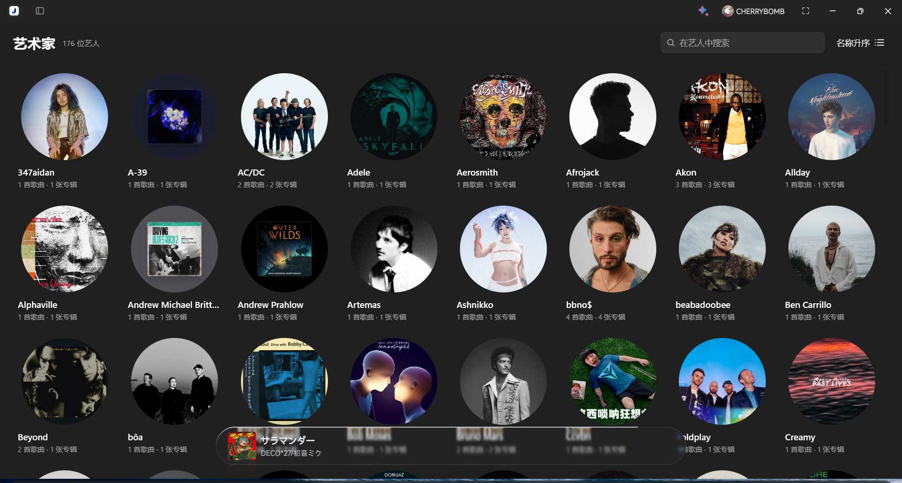

更多预览

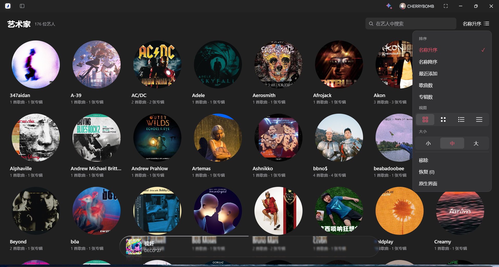

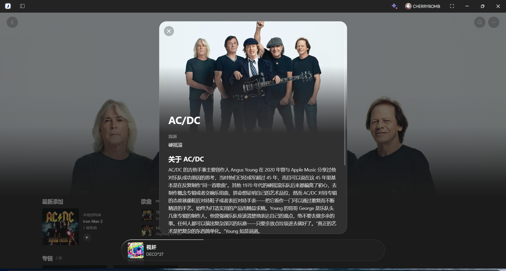

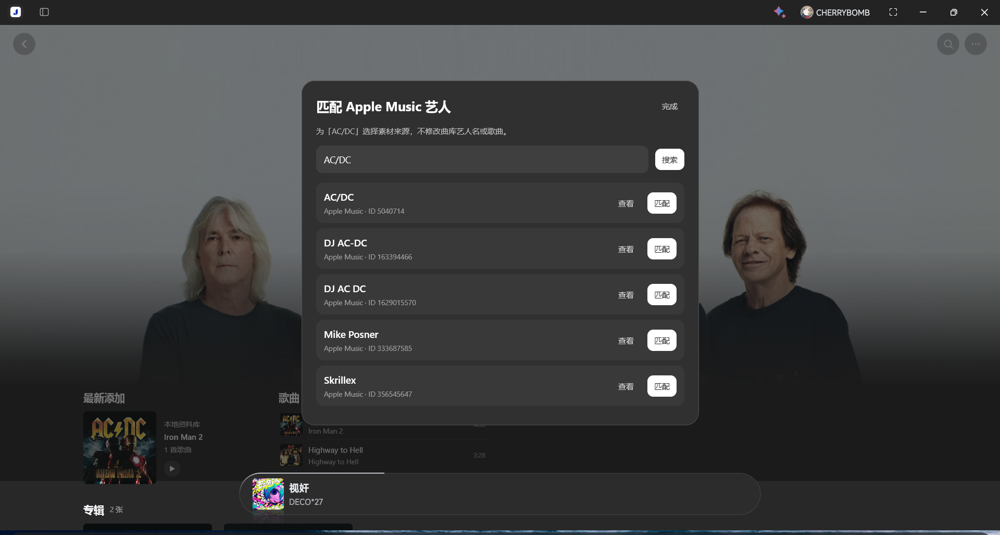

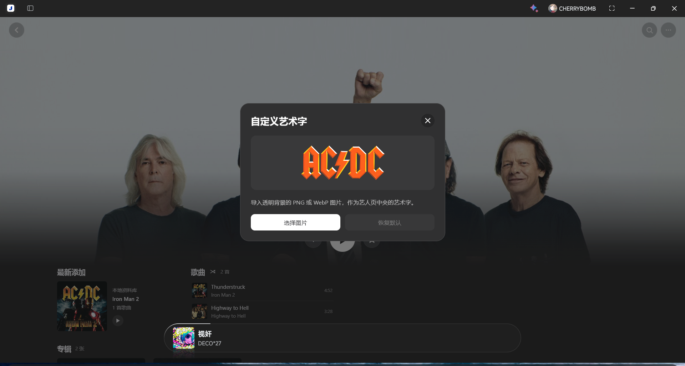

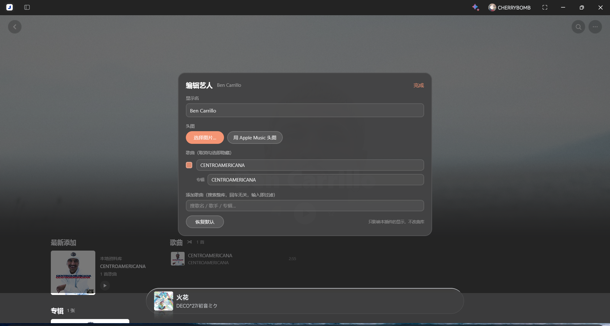

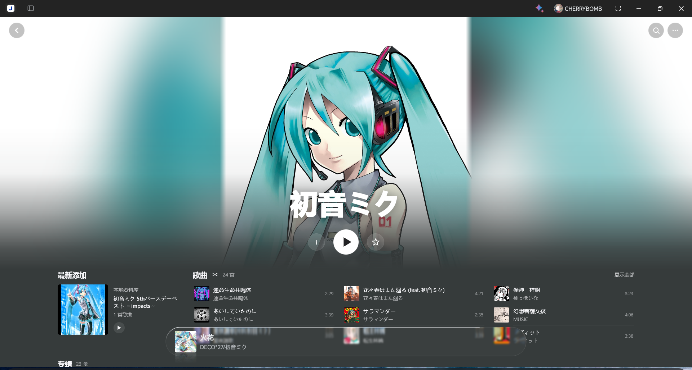

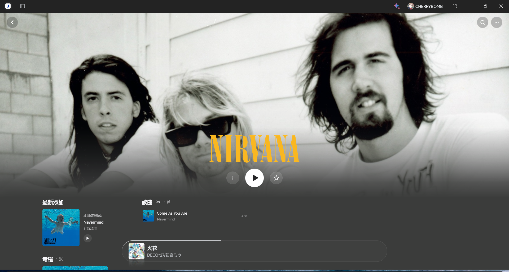

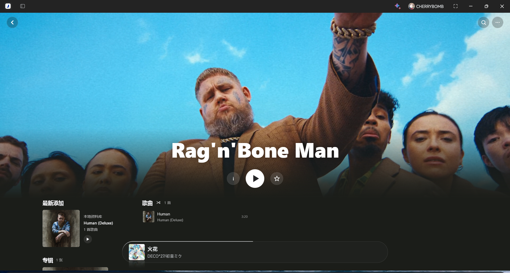

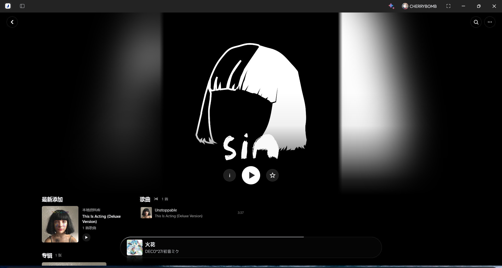

## 安装与设置

1. 从 [Releases](https://github.com/asukua/salt-artist/releases/latest) 下载 `.spmod`，在 SPW「模组管理」中导入并启用。
2. 打开艺人页即可使用。在「Salt Artist → 配置」里调整帧率、清晰度、资料语言和匹配方式。
3. 艺人页右上角更多菜单可手动匹配、换头图和导入艺术字；列表右上角可调整视图、排序和移除恢复。

匹配不到 AM 素材时沿用曲库封面；没有艺人资料时显示本地曲库信息。自定义与收藏保存在插件配置中，不修改音乐文件；停用或卸载后恢复原生页面。头图、头像、艺术字和艺人资料从 AM 获取并缓存在本地，也可以换成自己的头图和艺术字。

## 开发

使用 **JDK 25**，运行 `./gradlew test plugin`（Windows：`.\gradlew.bat test plugin`）。产物为 `build/libs/plugin-dev.saltartist-0.2.4.spmod`，首次构建需要联网获取依赖。接入与运行约束见[兼容说明](docs/host-compatibility.md)，实现与设计见[设计文档](docs/artist-design.md)。

## 致谢

感谢 Salt Player for Windows 和 [Moriafly/spw-workshop-api](https://github.com/Moriafly/spw-workshop-api) 提供插件支持。Salt Artist 是第三方社区项目，与 Salt Player、Apple 无官方关联。

源码采用 [Apache License 2.0](LICENSE)。预览中的第三方素材见[第三方声明](THIRD_PARTY_NOTICES.md)。
